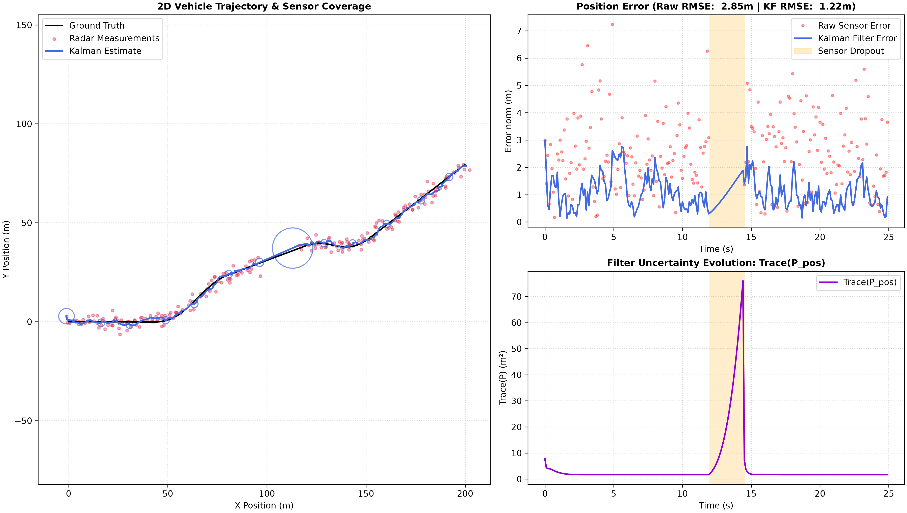

# Tracking a Vehicle with a Kalman Filter
Estimating the position and velocity of a manoeuvring vehicle from noisy, 
position-only radar, and measuring how well it actually works.


*White dot: the real vehicle. Red dots: what the radar reports. Cyan: the filter's
estimate, with its 2σ uncertainty. The radar cuts out between 12 and 14.5 seconds,
watch the uncertainty swell, then snap back.*

**Over 30 random seeds, the tuned filter reduces position RMSE from 2.83 m to
1.30 m: a 54% improvement on the raw radar, and 40% better than a causal
moving-average baseline.**


## Overview
A radar reports where a vehicle is, badly, and nothing else. It never reports how
fast the vehicle is moving; yet velocity is what we need to
predict where the vehicle will be next.

Simply averaging the noisy readings reduces the jitter but lags behind every
turn. A Kalman filter does better by carrying a model of how vehicles move, and
in doing so it recovers velocity it was never told: position and velocity become
correlated inside the covariance matrix, so learning about one teaches it about
the other.

The catch is that the model is a lie. Our filter assumes constant velocity;
the vehicle steers. This project builds the filter, then measures what that
mismatch actually costs; how to tune around it, whether the filter stays honest
about its own uncertainty, and how fast it degrades when the radar goes dark.


## Results             



*Left: the trajectory with 2σ uncertainty ellipses. Top right: raw versus filtered
error, with the sensor dropout shaded. Bottom right: the filter's own uncertainty,
which balloons during the blackout and collapses the moment the radar returns.*

### 1. Does the filter beat the simple alternatives?

Position RMSE over 30 random seeds, same trajectory and noise parameters
throughout:

| Method | RMSE (m) |
|---|---|
| Raw radar | 2.832 ± 0.106 |
| Moving average, causal (5-point) | 2.182 ± 0.125 |
| **Kalman filter** | **1.301 ± 0.101** |
| Moving average, centred (5-point) | 1.261 ± 0.085 |

The filter is **54% better than the raw radar** and **40% better than the causal
moving average**; a 0.88 m gap against a seed-to-seed spread of 0.1 m, so a real
effect rather than a lucky run.

**On the last row.** The centred moving average beats the filter, but not fairly:
a centred window averages each point with its neighbours on *both* sides, so it
uses measurements that have not arrived yet. It is a smoother, not a filter; the
Kalman filter at step *k* has only seen steps 0 through *k*. We kept the row
rather than dropping the comparison that loses; the like-for-like version would
be a Kalman smoother (RTS), listed under future work.


### 2. How should Q and R be tuned?

We swept the filter's assumed `q` over five orders of magnitude and `r` across
seven values, 3 seeds per cell, while holding the simulator's actual noise fixed.
Only the filter's *beliefs* change, the world stays the same.

Filter RMSE at `r_std = 2.0`:

| q | RMSE (m) |
|---|---|
| 0.01 | 4.581 |
| 0.1 | 3.658 |
| 1 | 2.089 |
| 10 | 1.365 |
| **31.6** | **1.319** |
| 100 | 1.402 |
| 1000 | 1.727 |

**Best cell: q = 31.62, r_std = 2.0, RMSE 1.319 m.**

Three things fall out.

**`r` wants the truth.** The optimum `r_std` is 2.0, exactly the simulator's
measurement noise. Tell the filter the truth about its sensor and it performs
best.

**`q` does not.** The simulator's process noise is σ = 0.15 m/s², so the "true"
`q` is 0.0225. The optimum is **1,400× larger**.

That is not an error, and it is the most interesting finding here. `q` does not
represent the random acceleration kicks, it represents **everything the model
does not know about**, and the scripted S-curve manoeuvres dwarf the random
component. From the filter's point of view a deliberate steering input and a
random gust are indistinguishable: both are accelerations a constant-velocity
model cannot represent.

Tuning `q` from the simulator's noise parameter would give **4.32 m RMSE, 
3.3× worse than the swept optimum, and worse than using the raw radar readings
at all (2.83 m)**. A filter can be correctly implemented, handed the true noise
statistics, and still be actively harmful.

**The basin is asymmetric.** Moving 1.5 decades below the optimum costs 58%;
moving 1.5 decades above costs 31%. Underestimating `q`, being too confident in
our model, is roughly twice as expensive as overestimating it. 


### 3. Is the filter honest about its own uncertainty?

RMSE only tells you how far wrong the filter is. It says nothing about whether
the filter *knows* how wrong it is, and a filter that tracks well while
understating its own uncertainty is dangerous, because anything downstream will
trust it too much.

**NEES** (normalised estimation error squared) measures that. At each step it
scales the error by the filter's own covariance: `eᵀ P⁻¹ e`. For a 4-dimensional
state, a well-calibrated filter averages **4**. Much higher means overconfident;
much lower means needlessly timid.

| q | NEES |
|---|---|
| 0.01 | 1851.9 |
| 0.1 | 364.8 |
| 1 | 47.6 |
| 10 | 6.9 |
| **31.6** | **3.6** |
| 100 | 2.6 |
| 1000 | 2.3 |

At small `q` the filter is catastrophically overconfident: a NEES of 1852 against
a target of 4 means its true error is roughly **21× larger than its claimed
standard deviation**. It is tracking badly and insisting it is fine. As `q` rises
the filter admits more doubt, NEES falls through 4 near q = 31.6, and beyond
q ≈ 100 it overcorrects into claiming more uncertainty than it actually has.

**The result: both criteria pick the same tuning.** RMSE is minimised at
q = 31.62 and NEES lands closest to 4 at q = 31.62: two independent measures,
one about accuracy and one about honesty, agreeing. There was no guarantee of
this: inflating `q` to absorb deterministic steering could easily have bought
accuracy at the cost of a covariance that no longer described reality.

*Caveat: our grid steps by a factor of 3.16, so the two optima agree to within
one grid step rather than exactly. A finer sweep between 10 and 100 would
tighten that.*


### 4. How gracefully does it survive a radar blackout?

Peak position error during blackouts of increasing length, averaged over 5 seeds:

| Blackout | Peak error | Ratio to previous |
|---|---|---|
| 0.5 s | 0.75 m | — |
| 1.0 s | 1.03 m | ×1.37 |
| 2.0 s | 1.58 m | ×1.53 |
| 4.0 s | 3.13 m | ×1.98 |
| 8.0 s | 9.71 m | ×3.10 |

Short blackouts cost almost nothing, at 0.5 s the peak error is roughly the
filter's normal operating error. But the growth **accelerates**: each
doubling of the gap costs more than the last.

**There is theory behind that curve.** With no measurements, the velocity
estimate performs a random walk, so its error grows as √t. Position is the
integral of velocity, so position error grows as **t^1.5**.

Converting the ratios to exponents (a doubling that multiplies error by 2^k):
```
×1.37 → k = 0.45
×1.53 → k = 0.61
×1.98 → k = 0.99
×3.10 → k = 1.63
```

The exponent climbs toward 1.5 as the gap lengthens and the filter's baseline
error stops dominating. At 8 seconds we measure 1.63 against a predicted 1.5, 
slightly above, which is consistent with the vehicle also manoeuvring during
the gap, something the theory does not account for.

Crucially, the filter *knows* it is lost: `trace(P)` rises from ~2 m² to ~75 m²
during the blackout and collapses the moment a measurement returns. 


## How it works
### The simulated world                              
In `simulator.py`: the module builds a challenging 2D synthetic environment that forces the filter to handle the chaotic realities of physical sensors. The vehicle navigates a 2D Cartesian plane over a specified time horizon (e.g., 250 time steps at Δt = 0.1s). 

The true state is [x, y, vₓ, v_y], and each step applies the constant-velocity transition matrix F: positions advance by velocity × Δt and velocities carry over unchanged.
On top of this runs a discrete white noise acceleration (DWNA) model. At every step the vehicle receives an independent, zero-mean Gaussian acceleration kick (σ = 0.15 m/s²). “White” means the kicks are uncorrelated in time, so the vehicle has no memory of past kicks and no predictable pattern. The resulting process covariance Q = σ²·GGᵀ, with G = [Δt²/2, Δt], correctly links position and velocity errors.

The motion is deliberately not constant-velocity. Two scripted sinusoidal steering inputs are added to the y-velocity, one pushing north between steps 50 and 100 and one pushing south between steps 150 and 190. Together they bend the path into an S-curve. These are unmodelled accelerations, which is what exposes the lag and overshoot of a constant-velocity filter in the turns.

The radar sees position only. A measurement matrix H selects [x, y] from the truth, and Gaussian noise (σ = 2.0 m) is added. The simulator then injects two sensor faults. Dropouts replace a window of measurements with NaN, so the sensor loses the target while the truth always exists. False echoes add a random-sign offset of 20–35 m on each axis at chosen steps, mimicking radar glint. All randomness comes from one seeded np.random.default_rng, so every run is reproducible and the 30-seed benchmark is fair.


### The filter                                       
In `kalman.py`. The state is `[x, y, vx, vy]`: where the vehicle is and how fast
it is moving. The radar only ever supplies the first two.

Five matrices define it:

| | Meaning |
|---|---|
| `F` | How the state advances in one timestep: position += velocity × Δt, velocity unchanged |
| `H` | What the sensor sees of the state. Its velocity columns are **zero**; the radar is structurally blind to velocity |
| `Q` | How wrong the constant-velocity model is. Built from a single scalar `q` via the DWNA model |
| `R` | How much the radar lies. `σ² · I` |
| `P` | How unsure the filter currently is, and about what |

`Q` has off-diagonal terms because position error and velocity error come from
the *same* random acceleration, so they are perfectly correlated. Those terms,
and the matching ones that build up in `P`, are what let a position-only sensor
teach the filter about velocity.

The loop runs predict, then update, then record:
```
predict   x ← Fx                 P ← FPFᵀ + Q
update    y ← z − Hx             (the innovation)
          S ← HPHᵀ + R
          K ← PHᵀS⁻¹             (the Kalman gain)
          x ← x + Ky             P ← (I − KH)P
```

`P` grows during predict, time passing makes the filter less sure, and shrinks
during update, because a measurement arrived. `K` decides how much of the
innovation to believe: large `R` drives it toward zero and the filter ignores
the radar; small `R` and it chases every reading.

The filter starts deliberately ignorant: `x` takes its position from the first
measurement with zero velocity, and `P` starts at 100 on every diagonal. It
works out the velocity within a few steps.

**Missing measurements** are NaN rows. The filter runs predict and skips update
entirely, so it coasts on its model while `P` grows.


### The figures                                     
`plot_static_study` builds the three-panel figure shown above.

Trajectory (left). The black line is the ground truth, the red dots are the radar hits (dropout steps are omitted), and the blue line is the Kalman estimate. The size of the ellipses shows how uncertain the filter is, and their tilt shows correlation between x and y uncertainty.

Position error vs time (top right). Red dots are the raw radar error and the blue line is the filter error, both as the Euclidean distance to the truth. The filter error sits well below the radar scatter in steady driving and rises during the manoeuvres and the blackout.

Uncertainty vs time (bottom right). The purple curve is trace(P_pos) = Var(x) + Var(y) in m². It shrinks to a steady value while measurements arrive, grows during the dropout, and drops again once the radar returns.

`create_animation` renders the same run as a GIF. A camera follows the vehicle, the last 12 radar hits are shown, and a dashed 2σ ellipse swells and shrinks with the filter’s confidence.


## Project structure
| File | Purpose | Author |
|---|---|---|
| `simulator.py` | Generates the true trajectory and the noisy radar measurements, including manoeuvres, dropouts and false echoes | Anne |
| `kalman.py` | The Kalman filter: state transition, measurement and noise matrices, predict/update cycle | Yağmur |
| `benchmark.py` | The four experiments and the metrics they use (RMSE, moving average, NEES) | Yağmur |
| `visualize.py` | The three-panel static study and the tracking animation | Anne |
| `main.py` | Wires the modules together for a single run and writes the figures | both |
| `test_kalman.py` | Unit tests for the filter | Yağmur |
| `test_benchmark.py` | Unit tests for the metrics | Yağmur |
| `test_simulator.py` | Unit tests for the simulator | Anne |
| `test_visualize.py`    | Unit tests for the covariance-ellipse geometry and figure output                                | Anne |
| `sweep_results.npz` | Saved sweep arrays, so plots can be redrawn without re-running | generated |
| `figures/` | Output figures and animation | generated |


## How to run it
```bash
git clone https://github.com/yagmur-cam/autonomous-vehicle-simulation.git
cd autonomous-vehicle-simulation

python -m venv .venv
source .venv/bin/activate #Windows: .\.venv\Scripts\Activate.ps1

pip install -r requirements.txt
```

| Command | What it does |
|---|---|
| `python main.py` | One tracking run with a sensor dropout. Writes both figures into `figures/`. |
| `python benchmark.py` | All four experiments. Prints the results table and saves the sweep arrays. Takes about 30 seconds. |
| `pytest` | The 23 tests. |


## Tests                                             
23 tests, across the four modules, run with `pytest`.

`test_kalman.py` has six tests on the filter. Two check the matrices: `F` is
(4,4), and `H` gives the same measurement for two states with identical position
but wildly different velocity, the radar must be blind to velocity. The
strongest test feeds noise-free measurements and requires the filter to recover
the truth, including the velocity it was never given, to within 1e-6. 

`test_benchmark.py` has seven tests on the metrics. The important one feeds a
step function to `moving_average` and asserts the causal version has not yet
reacted at the index before the jump while the centred version has. 

`test_simulator.py` has six tests. They check that the same seed gives byte-identical arrays and different seeds give different data. They check the output shapes, (N, 4) for truth and (N, 2) for measurements. A kinematics test uses zero process noise and confirms x = v·t before the first manoeuvre. 

`test_visualize.py` has four tests on the ellipse geometry. A diagonal covariance (variances 9 and 4) must give a 12 × 8 ellipse at 0°. A correlated matrix with eigenvalues 8 and 2 must tilt to 45°. A zero covariance must stay finite and positive.


## Limitations                                      
**The noise is Gaussian by construction**, so it matches the filter's assumptions
exactly. A real radar has heavier tails, which makes these results optimistic.

**The manoeuvres are scripted** at fixed steps, and only the y-velocity is
perturbed; so the vehicle speeds up through turns rather than changing
direction at constant speed. This is not a vehicle model.

**Dropouts are clean NaN windows** at fixed times. Real sensors degrade
gradually rather than switching off.

**The radar reports Cartesian x/y**, while real radars measure range and bearing, 
a nonlinear measurement that a plain Kalman filter cannot handle.

**The two RMSE figures in the error panel are not over the same steps.** The raw
error excludes dropout steps (there is no measurement to compare), while the
filter error includes them. The filter's number is therefore slightly
pessimistic relative to the radar's.


## Future work                                       
- **Extended Kalman filter with range and bearing.** Real radars measure range
  and angle, not `(x, y)`, a nonlinear measurement that needs a Jacobian.
- **RTS smoother.** The like-for-like comparison against the centred moving
  average that beat us in Result 1.
- **Mahalanobis gating.** `simulator.py` already generates false echoes; nothing
  uses them yet.
- **Constant-turn-rate model.** Would represent steering explicitly, and should
  shrink the 1,400× gap between optimal `q` and the true process noise.
- **Finer tuning grid.** Our sweep steps by 3.16×, so the RMSE and NEES optima
  agree only to within one grid step.


## Authors
- **Yağmur Çam** ([@yagmur-cam](https://github.com/yagmur-cam)): Kalman filter, benchmarking and tuning experiments
- **Anne Fernando** ([@Mbmiquella](https://github.com/Mbmiquella)): simulator, visualisation and animation

Built as a self-directed project alongside our second year of Applied Computer Science and AI at Sapienza University of Rome.
