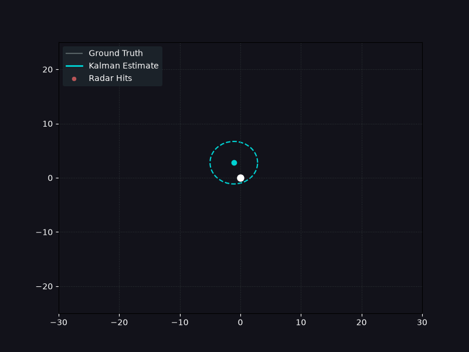

# Tracking a Vehicle with a Kalman Filter

Estimating the position and velocity of a manoeuvring vehicle from noisy, 
position-only radar, and measuring how well it actually works.



*White dot: the real vehicle. Red dots: what the radar reports. Cyan: the filter's
estimate, with its 2σ uncertainty. The radar cuts out between 12 and 14.5 seconds,
watch the uncertainty swell, then snap back.*

**Over 30 random seeds, the tuned filter reduces position RMSE from 2.83 m to
1.30 m: a 54% improvement on the raw radar, and 40% better than a causal
moving-average baseline.**


## Overview                                          [both — write last]
What the problem is, why position-only tracking of a manoeuvring
vehicle is non-trivial. Three or four sentences.


## Results                                           [Yağmur]
### 1. Does the filter beat the simple alternatives?
    RMSE table + the causal/non-causal distinction
### 2. How should Q and R be tuned?
    the sweep, the heatmap, why optimal q is 1400x the noise parameter
### 3. Is the filter honest about its own uncertainty?
    the NEES sweep, why both criteria agree
### 4. How gracefully does it survive a radar blackout?
    the dropout curve, the t^1.5 match with theory


## How it works
### The simulated world                              

In `simulator.py`: the module builds a challenging 2D synthetic environment that forces the filter to handle the chaotic realities of physical sensors. This helps to prove the robustness of the Kalman Filter. The vehicle navigates a 2D Cartesian plane over a specified time horizon (e.g., 250 time steps at Δt = 0.1s). 

The true state is [x, y, vₓ, v_y], and each step applies the constant-velocity transition matrix F: positions advance by velocity × Δt and velocities carry over unchanged.
On top of this runs a discrete white noise acceleration (DWNA) model. At every step the vehicle receives an independent, zero-mean Gaussian acceleration kick (σ = 0.15 m/s²). “White” means the kicks are uncorrelated in time, so the vehicle has no memory of past kicks and no predictable pattern. The resulting process covariance Q = σ²·GGᵀ, with G = [Δt²/2, Δt], correctly links position and velocity errors.

The motion is deliberately not constant-velocity. Two scripted sinusoidal steering inputs are added to the y-velocity, one pushing north between steps 50 and 100 and one pushing south between steps 150 and 190. Together they bend the path into an S-curve. These are unmodelled accelerations, which is what exposes the lag and overshoot of a constant-velocity filter in the turns.

The radar sees position only. A measurement matrix H selects [x, y] from the truth, and Gaussian noise (σ = 2.0 m) is added. The simulator then injects two sensor faults. Dropouts replace a window of measurements with NaN, so the sensor loses the target while the truth always exists. False echoes add a random-sign offset of 20–35 m on each axis at chosen steps, mimicking radar glint. All randomness comes from one seeded np.random.default_rng, so every run is reproducible and the 30-seed benchmark is fair.


    

### The filter                                       [Yağmur]
    state vector, the five matrices, predict/update, NaN handling


### The figures                                     

plot_static_study produces one three-panel figure (figures/kalman_study.png).

Trajectory (left). The black line is the ground truth, the red dots are the radar hits (dropout steps are omitted), and the blue line is the Kalman estimate. Blue 2σ ellipses are drawn every 20 steps, built from the position block of the covariance P by eigendecomposition. Their size shows how uncertain the filter is, and their tilt shows correlation between x and y uncertainty.

Position error vs time (top right). Red dots are the raw radar error and the blue line is the filter error, both as the Euclidean distance to the truth. Orange bands mark the dropout, and the title reports both RMSEs. The filter error sits well below the radar scatter in steady driving and rises during the manoeuvres and the blackout.
Uncertainty vs time (bottom right). The purple curve is trace(P_pos) = Var(x) + Var(y) in m². It shrinks to a steady value while measurements arrive, grows during the dropout because the filter predicts without corrections, and drops again once the radar returns.

create_animation renders the same run as a GIF (figures/tracking.gif, 15 fps). A camera follows the vehicle, the last 12 radar hits are shown, and a dashed 2σ ellipse swells and shrinks with the filter’s confidence.


## Project structure

| File | Purpose | Author |
|---|---|---|
| `simulator.py` | Generates the true trajectory and the noisy radar measurements, including manoeuvres, dropouts and false echoes | Anne |
| `kalman.py` | The Kalman filter: state transition, measurement and noise matrices, predict/update cycle | Yağmur |
| `benchmark.py` | The four experiments and the metrics they use (RMSE, moving average, NEES) | Yağmur |
| `visualize.py` | The three-panel static study and the tracking animation | Anne |
| `main.py` | Wires the modules together for a single run and writes the figures | both |
| `test_kalman.py` | Unit tests for the filter | Yağmur |
| `test_benchmark.py` | Unit tests for the metrics | Yağmur |
| `test_simulator.py` | Unit tests for the simulator | Anne |
| `sweep_results.npz` | Saved sweep arrays, so plots can be redrawn without re-running | generated |
| `figures/` | Output figures and animation | generated |


## How to run it

```bash
git clone https://github.com/yagmur-cam/autonomous-vehicle-simulation.git
cd autonomous-vehicle-simulation

python -m venv .venv
source .venv/bin/activate #Windows: .\.venv\Scripts\Activate.ps1

pip install -r requirements.txt
```

| Command | What it does |
|---|---|
| `python main.py` | One tracking run with a sensor dropout. Writes both figures into `figures/`. |
| `python benchmark.py` | All four experiments. Prints the results table and saves the sweep arrays. Takes about 30 seconds. |
| `pytest` | The 23 tests. |


## Tests                                             [both]
 23 tests, what they cover, one line on the interesting ones

`test_simulator.py` has six tests. They check that the same seed gives byte-identical arrays and different seeds give different data. They check the output shapes, (N, 4) for truth and (N, 2) for measurements. A kinematics test uses zero process noise and confirms x = v·t before the first manoeuvre. Dropout windows must be exactly NaN with no stray NaNs elsewhere and none in the truth. Injected outliers must land more than 10 m from the truth.

`test_visualize.py` has four tests on the ellipse geometry. A diagonal covariance (variances 9 and 4) must give a 12 × 8 ellipse at 0°. A correlated matrix with eigenvalues 8 and 2 must tilt to 45°. A zero covariance must stay finite and positive. A smoke test confirms the PNG and GIF are actually written.

## Limitations                                       [both — do not skip]
    constant-velocity lag in turns, injected dropouts,
    Gaussian-by-construction noise, Cartesian not range-bearing

The simulated noise is Gaussian by construction, so it matches the filter’s assumptions. 
A real radar has heavier tails, so the results are optimistic. Dropouts are clean NaN windows at fixed times, whereas real sensors degrade gradually. 
The manoeuvres are scripted at fixed steps in one scenario, and only the y-velocity is perturbed, so speed is not conserved in turns. 
This is not a real vehicle model. The radar reports Cartesian x/y, while real radars measure range and bearing.
The panel-2 RMSE figures also compare different sets of steps (see the advice below).

## Future work                                       [both]
    EKF with range/bearing, RTS smoother, Mahalanobis gating


## Authors

- **Yağmur Çam** ([@yagmur-cam](https://github.com/yagmur-cam)): Kalman filter, benchmarking and tuning experiments
- **Anne Fernando** ([@Mbmiquella](https://github.com/Mbmiquella)): simulator, visualisation and animation

Built as a self-directed project alongside our second year of Applied Computer Science and AI at Sapienza University of Rome.
